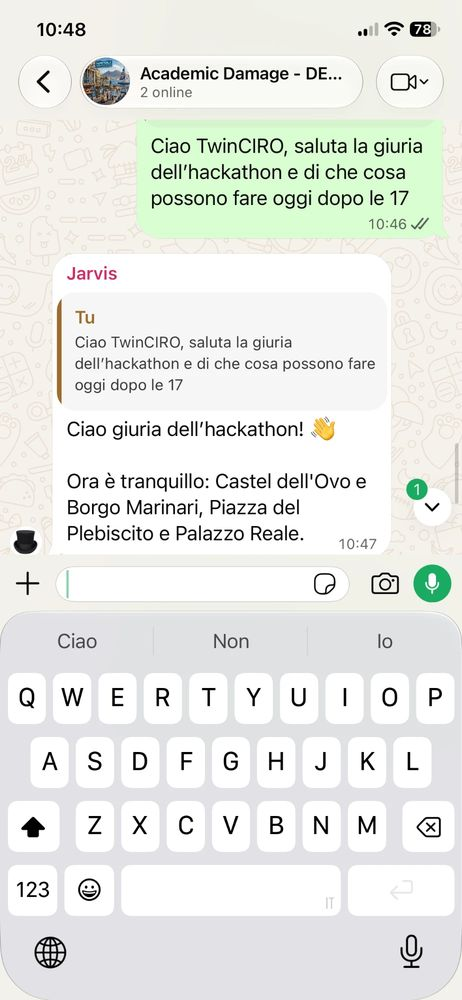
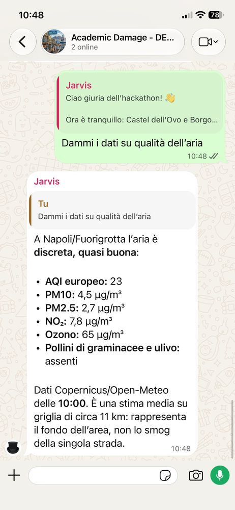
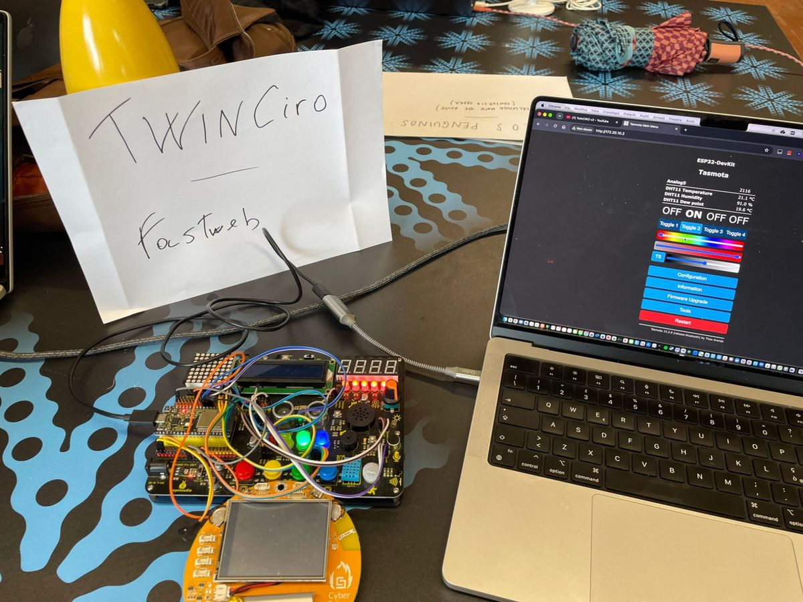
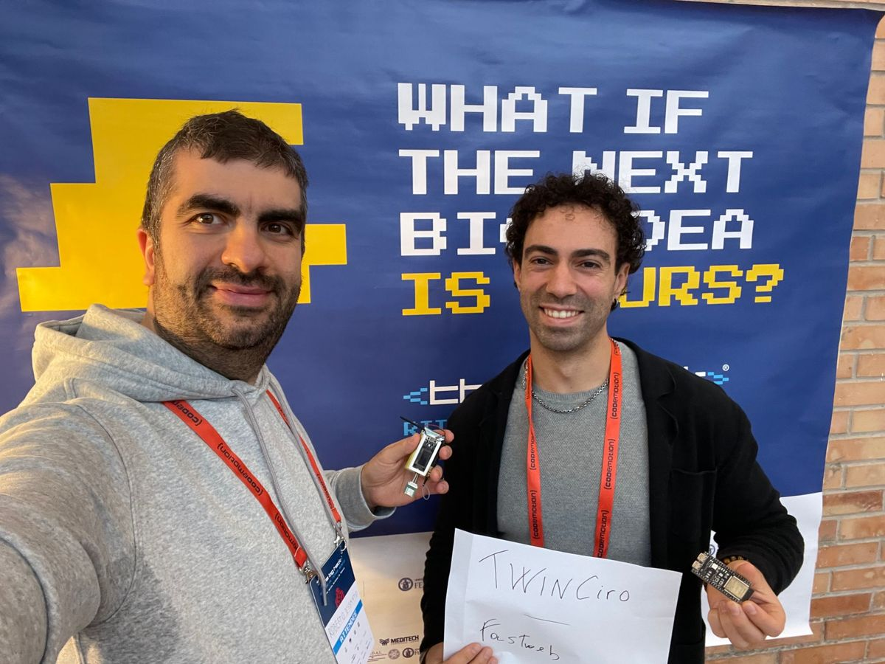

# TwinCIRO · Napoli che ci pensa

**TwinCIRO è l'assistente della città su WhatsApp.** Dietro c'è un sistema multi-agente con un gemello digitale di Napoli. Turisti e cittadini gli scrivono come a un amico, e lui risponde con i dati veri della città, citando sempre fonte e ora del dato. Chiede agli agenti della città e tratta con le imprese, per esempio una pizzeria piena che propone un altro orario. Quando una zona si riempie scrive per primo, dopo l'ok dell'operatore della Polizia Locale. *Twin* sta per gemello digitale, *CIRO* per City Intelligence & Responsive Orchestration.

[The Big Hack 2026](https://go.codemotion.com/big-hack-hackathon-2026/) (Codemotion × Futuro Remoto), Città della Scienza, Napoli, 14–15 novembre 2026. Challenge 05 **Fastweb + Vodafone**, *«Napoli Agentic City»*.

| | |
|---|---|
| 🖥️ **Per l'operatore** | **[TwinCIRO 3D](https://robertodisanto.it/hackathon_2026_a/c5-presentazione/gemello-3d/)**, la dashboard della sala operativa: il gemello digitale di Napoli con presenze adesso e previste, e scenari «e se…» |
| 💬 **Per turisti e cittadini** | **TwinCIRO su WhatsApp**: il link per entrare nel gruppo è **sulla piattaforma dell'hackathon** |
| 📚 **Le fonti** | **[oltre 50 fonti pubbliche di Napoli, verificate una per una](docs/fonti-dati-napoli.md)**, con licenza, limiti ed esito delle prove |
| 🌐 **Altre pagine** | [mappa «Napoli in tempo reale»](https://robertodisanto.it/hackathon_2026_a/c5-presentazione/mappa/) · [Napoli come rete di relazioni](https://robertodisanto.it/hackathon_2026_a/c5-presentazione/grafo/) · [la regata in 3D](https://robertodisanto.it/hackathon_2026_a/c5-agentic-city/visore3d/) · [tutte le pagine](https://robertodisanto.it/hackathon_2026_a/) |

## È tutto vero

**TwinCIRO risponde davvero, nel gruppo WhatsApp della demo**, con dati veri e la loro fonte. Nel gruppo l'agente compare con il nome del suo account WhatsApp, «Jarvis».

  
  

**I sensori sono fatti da noi.** Nella foto c'è una scheda ESP32 con Tasmota che legge temperatura e umidità (DHT11: 21,1 °C, 91%). Sotto c'è il badge Cyber Saiyan WHY2025, per cui abbiamo scritto il firmware. Per tutti e due abbiamo preparato la configurazione che pubblica nel formato MQTT della città, `napoli/...` ([`firmware/`](firmware/README.md)).

- **Dati veri:** meteo, aria, allerte della Protezione Civile, treni, metro, bus ed eventi arrivano da [fonti pubbliche verificate](docs/fonti-dati-napoli.md) attraverso una sola API ([`citta-api/`](citta-api/README.md)), con cache, riserve dichiarate e fonte e ora di ogni dato. Mai dati inventati.
- **Server vero:** broker MQTT e API dei dati sono attivi su `twinciro.robertodisanto.it` ([`cloud/`](cloud/README.md)).
- **Simulato, e dichiarato come tale:** la folla stimata per zona (oggi non ci sono dati di presenza aperti), le offerte delle imprese e lo scenario della regata dell'America's Cup 2027.

## Come funziona

**Badge e scheda Tasmota** → **MQTT `napoli/...`** → **agenti della città** (Python, con un orchestratore) → **TwinCIRO su WhatsApp** (agente OpenClaw), che prende i dati veri dall'API dati città.

- **Due utenti:** chi visita Napoli, su WhatsApp, e chi la governa, in sala operativa. Gli agenti propongono, l'operatore approva o blocca.
- **Agenti specializzati:** folla, eventi, meteo e mare, mobilità, turismo, imprese. Si parlano su MQTT e un orchestratore decide.
- **Gemello digitale:** prova la giornata sulle strade vere prima che accada ([TwinCIRO 3D](https://robertodisanto.it/hackathon_2026_a/c5-presentazione/gemello-3d/), [regata in 3D](https://robertodisanto.it/hackathon_2026_a/c5-agentic-city/visore3d/)).
- **LLM a scelta, anche italiano:** gli agenti funzionano con Claude o con qualsiasi API compatibile con OpenAI, come [MIIA di Fastweb](https://huggingface.co/Fastweb/FastwebMIIA-7B). L'integrazione è pronta e provata con server compatibili, non ancora con MIIA. Senza LLM decidono le regole.

## Con Fastweb + Vodafone

- **Il dato che manca, cioè quante persone ci sono adesso in ogni zona**, viene dalle analytics di rete degli operatori, aggregate e anonime: la folla non si simula più, si misura.
- **Le SIM IoT** portano i sensori dove non c'è Wi-Fi.
- **MIIA**, l'AI italiana di Fastweb, come LLM degli agenti: sovranità digitale.

## Il team

**Roberto D'Isanto** e **Mario Varlese**.

## Nella repo

| Cartella | Cosa c'è |
|---|---|
| [`c5-agentic-city/`](c5-agentic-city/README.md) | la città agentica: agenti, orchestratore, API per TwinCIRO, gemello digitale, [skill di TwinCIRO](c5-agentic-city/openclaw/skills/README.md) |
| [`citta-api/`](citta-api/README.md) | API dati città: le fonti vere, con cache, riserve, fonte e ora di ogni dato (59 test) |
| [`firmware/`](firmware/README.md) | badge WHY2025 e scheda Tasmota, formato MQTT unico `napoli/...` |
| [`cloud/`](cloud/README.md) | broker MQTT e API in Docker sul server |
| [`c5-presentazione/`](c5-presentazione/README.md) | video (montaggio riproducibile, clip, sottotitoli, voce), [TwinCIRO 3D](c5-presentazione/gemello-3d/README.md), mappa, grafo |
| [`docs/`](docs/) | [le fonti](docs/fonti-dati-napoli.md), [la challenge](docs/hackathon.md), [il diario](docs/stato-e-strumenti.md) |

Avvio rapido della città: `cd c5-agentic-city && docker compose up -d` (agenti, gemello e API per TwinCIRO su :8080). L'API dei dati si avvia con `node citta-api/server.js` (porta 8791). Dettagli nei README delle cartelle.
